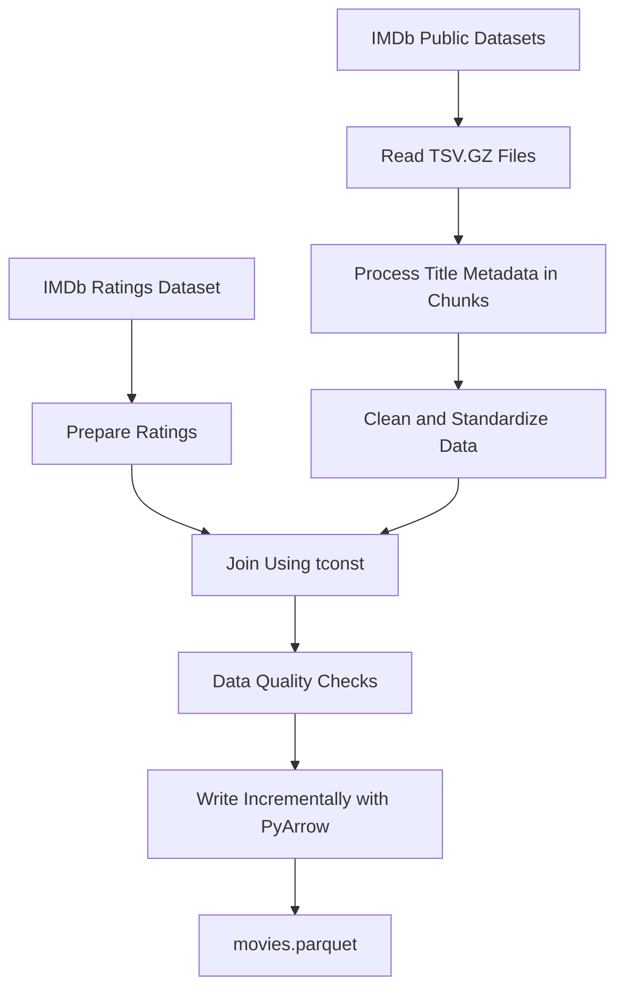

# IMDb Movie Data Ingestion Pipeline

A Python-based data engineering project that ingests public IMDb datasets, transforms movie metadata, combines ratings, validates data quality, and stores the results in Parquet format.

## Architecture



## Technologies

- **Python 3.12** — data processing
- **Pandas** — reading, cleaning, transforming, and joining datasets
- **PyArrow** — Parquet output with incremental writes
- **pytest** — automated testing
- **Git and GitHub** — version control and project hosting

## Data Sources

This project uses IMDb's publicly available datasets:

| Dataset | Description |
|---|---|
| `title.basics.tsv.gz` | Movie titles and metadata, including release year, runtime, and genres |
| `title.ratings.tsv.gz` | Average ratings and number of votes |

Source: https://datasets.imdbws.com/

IMDb datasets are subject to IMDb's usage and licensing terms.

## Pipeline Workflow

1. Read IMDb title metadata in chunks to reduce memory usage during processing.
2. Load and prepare IMDb ratings.
3. Filter the title metadata to include movies only.
4. Join movie records with ratings using the IMDb title identifier, `tconst`.
5. Standardize numeric columns and handle missing values.
6. Validate identifiers, rating ranges, and vote counts.
7. Write processed records incrementally to a single Parquet output file.

The pipeline uses a left join so that movies without available ratings remain in the output.

## Data Quality Checks

The pipeline and automated tests check:

- Movie identifiers are present and unique.
- Output contains movie records only.
- Required columns are present.
- Ratings are within the range of 0 to 10 when available.
- Vote counts are non-negative.
- The generated output exists and is not empty.

## Results

| Metric | Result |
|---|---:|
| Title records read | 12,852,122 |
| Movie records written | 759,083 |
| Automated tests | 6 passing |
| Output format | Parquet |
| Compression | Snappy |

**Output file:** `data/processed/movies.parquet`

The raw datasets and generated output are excluded from GitHub to keep the repository lightweight.

## Run Locally

### 1. Install dependencies

Activate your Python virtual environment, then install the required packages:

```bash
pip install pandas pyarrow pytest
```

### 2. Download the IMDb datasets

Download `title.basics.tsv.gz` and `title.ratings.tsv.gz` from https://datasets.imdbws.com/ and place both files in `data/raw/`.

### 3. Run the pipeline

```bash
python src/ingest_movies.py
```

### 4. Run automated tests

```bash
python -m pytest tests/test_ingest_movies.py -v
```

## Project Structure

```text
imdb-movie-pipeline/
├── data/
│   ├── raw/
│   └── processed/
├── src/
│   ├── ingest_movies.py
│   └── ingest_movies_sample.py
├── tests/
│   └── test_ingest_movies.py
├── .gitignore
└── README.md
```

## Current Status

**Completed**
- Local IMDb data ingestion and transformation
- Incremental Parquet output
- Data quality validation
- Six automated tests
- GitHub version control

**Planned enhancements**
- AWS S3 integration for cloud storage
- AWS Glue Data Catalog
- Querying Parquet data with Amazon Athena
- Workflow orchestration and cloud deployment

## Data and Repository Notes

This repository contains source code, tests, and documentation. Raw IMDb datasets, generated Parquet files, virtual environments, and credentials should not be committed to GitHub.

